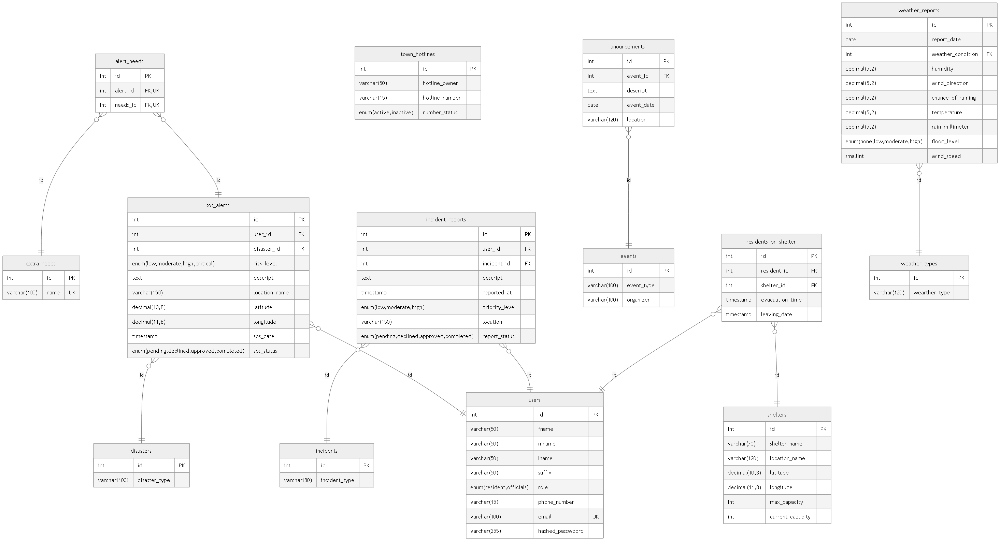

# Town Disaster Response and Monitoring Database Design 

## Requirements
A town wants to organize sos_alerts, incident_reports, and weather 
reports so the responders can easily track whether which place, what time,
and what happened during that particular event. The Town administrator also 
wants the users to receive on-time barangay announcements to keep everyone 
updated of what was currently happening. The town also wanted to keep track 
of evacuation shelter status so the users can be inform early before going
into it.

## Identities and attributes
Users = [Fullname, phone_no, birthdate, role, address] 
Disasters = [disaster type] 
SOS_Alert = [User Id, Disaster Id, risk level, description, location, date, status ] 
Needs = [Needs name] 
Alert_Needs  = [Alert Id, Needs Id] 
Incidents = [Incidents type] 
Incident_Reports = [User Id, Incidents Id, risk level, description, location, date, status ] 
Town_Hotlines = [hotline owner, hotline number, hotline status] 
Events = [Event type, Organizer] 
Announcements = [Event Id, Event Date, description, location] 
Shelters = [Shelter Name, Shelter location, current capacity, max capacity, shelter_status] 
Residents_On_Shelters = [User Id, Shelter Id, Evacuation date, leaving date] 
Weather Types = [Weather type] 
Weather Report = [report date, weather condition, humidity, wind direction, chance of raining, temperature, rain millimeter, flood_level, wind_speed] 

## ERD Table 

## Defining Relationships
1.) A user can have multiple sos_alerts and incident_reports  
2.) An sos_alerts and incident_reports can only belong to one person 
3.) A user can have multiple needs per sos_alerts 
4.) A needs can be requested by multiple users at a time. 
5.) A user can evacuate to one shelter at a time but can evacuate to different shelter over time. 
6.) A shelter can house many users. 
7.) An Event can be used for different announcements over time. 
8.) An Announcements can only have one event per time. 

## Features 
1.) Stored Procedure with a transaction inside 

## How to run 
1.) Import either implementation.sql or schema.dbml in your corresponding database application program 
2.) Import the seeding.sql to populate the Database 
3.) Try the sample queries provided 
